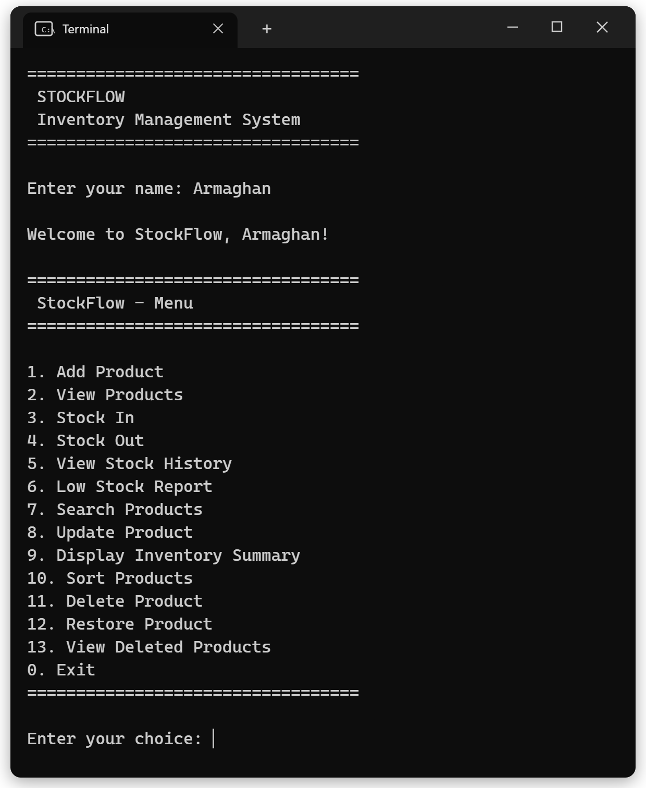

# StockFlow

**StockFlow** is a C# console-based inventory management application built with .NET 10. It allows users to manage products, track stock movements, monitor inventory levels, and generate basic inventory reports.

The project was developed to practise C# fundamentals, object-oriented programming, collections, exception handling, and JSON file persistence through a practical application.

Product prices and inventory values are represented in Pakistani Rupees (PKR).

## Preview



## Features

- **Product management** — add, view, update, soft-delete, and restore products
- **Stock operations** — stock-in and stock-out with quantity validation
- **Stock movement history** — a timestamped In/Out record for every stock change
- **Reports** — low-stock report and inventory summary (products, units, movements, stock value)
- **Search and sorting** — find products by name or SKU; sort the product list
- **Soft deletion and restoration** — deleted products and their history are retained
- **JSON-based persistence** — human-readable files with fail-fast loading on corrupt data
- **Input validation and friendly error handling** — clear prompts and actionable messages

## Technology

- **Language:** C#
- **Runtime:** .NET 10
- **Serialization:** `System.Text.Json`
- **Storage:** File-based JSON persistence (no database required)
- **Interface:** Console application with a numbered menu
- **Currency:** Pakistani Rupee (PKR)

## Project structure

```text
StockFlow.CLI/
├── .gitignore                       # Ignores build output, IDE files, and secrets
├── docs/                            # Project documentation
│   └── screenshots/                 # README screenshots
│       └── stockflow-cli.png
├── StockFlow.CLI.slnx               # Solution file
└── StockFlow.CLI/                   # Main project
    ├── StockFlow.CLI.csproj         # Project file (.NET 10)
    ├── Program.cs                   # Entry point and startup error handling
    ├── Data/                        # Sample inventory JSON files (see below)
    │   ├── README.md
    │   ├── products.json
    │   └── stock-movements.json
    ├── Enums/                       # MovementType (In / Out)
    ├── Models/                      # Product and StockMovement data models
    ├── Services/                    # Inventory logic and JSON file access
    │   ├── InventoryService.cs
    │   └── JsonFileService.cs
    └── UI/                          # Console menu and user input handling
        └── ConsoleUI.cs
```

## Getting started

### Prerequisites

- [.NET 10 SDK](https://dotnet.microsoft.com/download)

### Clone and run

```bash
git clone <repository-url>
cd StockFlow.CLI
dotnet build
dotnet run --project StockFlow.CLI/StockFlow.CLI.csproj
```

You can also run from the project folder with `cd StockFlow.CLI && dotnet run`, or launch the built DLL directly from `StockFlow.CLI/bin/Debug/net10.0/`.

The application resolves its `Data` directory by locating `StockFlow.CLI.csproj`, so it works regardless of the working directory. If the JSON files are missing, the app starts with an empty inventory and creates the files on the next save.

## Sample data

The included `StockFlow.CLI/Data/products.json` and `stock-movements.json` are **intentional sample data** so a fresh clone can immediately explore the application. They contain fictional office-accessory products, prices, quantities, and matching stock movements — no personal information. See `StockFlow.CLI/Data/README.md` for details.

For example, the included sample inventory is valued at PKR 2,187.38.

StockFlow reads and writes these files, so you can experiment freely. Deleting a file gives you a fresh start; a corrupted file stops startup with a clear error instead of silently replacing your data.

## Usage

After entering your name, the main menu offers:

| Option | Operation |
|---|---|
| 1 | Add product |
| 2 | View products |
| 3 | Stock in |
| 4 | Stock out |
| 5 | View stock history |
| 6 | Low-stock report |
| 7 | Search products |
| 8 | Update product |
| 9 | Inventory summary |
| 10 | Sort products |
| 11 | Delete product |
| 12 | Restore product |
| 13 | View deleted products |
| 0 | Exit |

Prompts validate input as you go: names are required, SKUs must be unique, prices and quantities must be valid positive numbers, and stock-out cannot exceed available quantity. Low-stock reporting asks for a non-negative threshold.

## Known limitations

- Console-based interface — no graphical or web UI
- Single-user, local-machine application
- Local JSON storage with no support for concurrent users or multiple processes writing at once
- No automatic backup or recovery; a corrupt file must be fixed manually
- Prices are represented in PKR, but formatting follows the system culture, so the displayed symbol may vary by machine
- Low-stock threshold is entered at runtime rather than configured as a saved setting

## Future improvements

Realistic possibilities for later, not commitments:

- Automated unit and integration tests
- Configurable currency/culture and a saved low-stock threshold
- CSV export for product lists and movement history
- Date-range filtering for stock history reports
- A simple backup written before each save
- Optional database persistence (the current project uses JSON files only)
